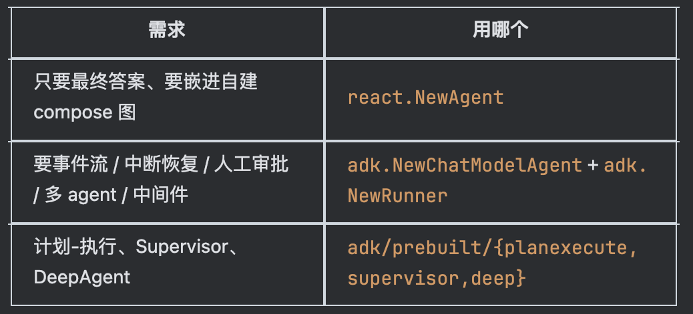

## 基础

Runner结构

```Go
type Runner struct {
    a Agent  // 要执行的 Agent，adk的agent而不是react的agent
    enableStreaming bool
    store CheckPointStore  // 用于中断恢复的状态存储
}

```

**为什么需要 Runner？** 

Agent它实现了基础的 react功能。但是像中断恢复它是没有集成的。Runner相当于游戏引擎；Agent是游戏角色，Runner可以负责加载、暂停、存档、推送实时事件，以及中断和恢复。

它主要抽象的4个核心能力包括：

1. **事件流封装：**把思考工具调用、返回文本事件拆成一个个事件吐出来。这个有什么好处呢？我们可以通过SSE拿到Agent执行的真正过程，细节是什么都可以直接看到。
2. **Checkpoint状态持久化+恢复：**跑一半可以暂停存快照，下一次断点续跑，可以使用在人机审批。有点类似于编程软件向用户申请权限，那个步骤。

## 注意

runner中的agent成员变量不是react包中的，而是adk中的



两者到底是什么

- **react.NewAgent（flow/agent/react，老版）**react.go:284 里就是手搓一个 compose.Graph：AddChatModelNode + AddToolsNode + AddBranch接口：Generate(ctx, []\*schema.Message) / Stream(...) / ExportGraph()输出就是一条最终消息，没有事件、没有 checkpoint、没有中断恢复好处：能 ExportGraph() 拆开嵌进你自己拼的大图里

  > 工具调用不会返回内容，无法监听事件，返回的是标准的assitent消息内容，以及思考内容
- **adk.NewChatModelAgent（新版 ADK 框架）**接口是 Name(ctx) + Description(ctx) + Run(ctx, \*AgentInput, ...) \*AsyncIterator[\*AgentEvent]多出来的东西：事件流（模型输出/工具结果分开成事件）、Instruction 直接当 system prompt、Handlers 中间件、重试/故障转移、MaxIterations、NewAgentTool 把 agent 当工具、StatefulInterrupt + ResumeWithParams 人工审批
