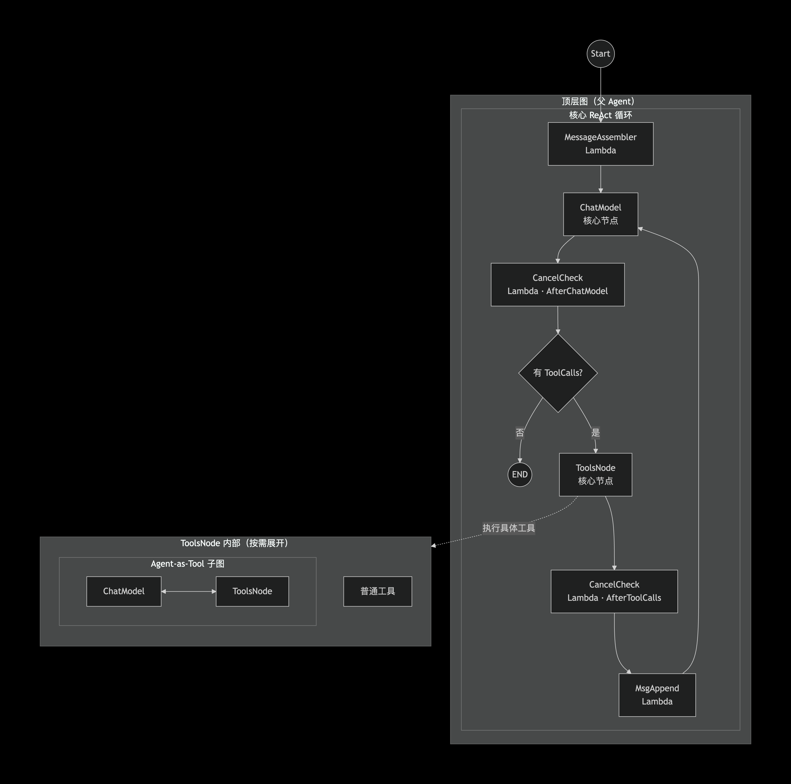

## 快速入门

和Runner搭配使用，可以用来记录每一个节点前后的一些行为，比如打印它的执行时长等。

- RunInfo：执行的节点详情
- AgentCallbackInput/AgentCallbackOutput：输入输出

```Go
import (
    "github.com/cloudwego/eino/adk"
    "github.com/cloudwego/eino/callbacks"
    template "github.com/cloudwego/eino/utils/callbacks"
)

helper := template.NewHandlerHelper().
    Agent(&template.AgentCallbackHandler{
        OnStart: func(ctx context.Context, info *callbacks.RunInfo, input *adk.AgentCallbackInput) context.Context {
            if input.Input != nil {
                fmt.Printf("Agent %s started with input\n", info.Name)
            } else {
                fmt.Printf("Agent %s resumed\n", info.Name)
            }
            return ctx
        },
        OnEnd: func(ctx context.Context, info *callbacks.RunInfo, output *adk.AgentCallbackOutput) context.Context {
            // 异步消费事件
            go func() {
                for {
                    event, ok := output.Events.Next()
                    if !ok {
                        break
                    }
                    // 处理事件...
                }
            }()
            return ctx
        },
    }).
    Handler()

// 创建 Runner - 必须通过 Runner 执行 Agent，callback 才会生效
runner := adk.NewRunner(ctx, adk.RunnerConfig{
    Agent:           agent,
    EnableStreaming: input.EnableStreaming,
})

iter := runner.Run(ctx, input.Messages, adk.WithCallbacks(helper))

```

## 注意

1. 回调 handler 中的 `AgentCallbackOutput.Events` **必须**异步消费，否则会阻塞 Agent 执行

```Go
// ✅ 正确
OnEnd: func(ctx context.Context, info *callbacks.RunInfo, output *adk.AgentCallbackOutput) context.Context {
    go func() {
        for {
            event, ok := output.Events.Next()
            if !ok {
                break
            }
            // 处理事件
        }
    }()
    return ctx
}

// ❌ 错误 - 会导致死锁
OnEnd: func(ctx context.Context, info *callbacks.RunInfo, output *adk.AgentCallbackOutput) context.Context {
    for {
        event, ok := output.Events.Next()
        if !ok {
            break
        }
        // 处理事件
    }
    return ctx
}
```

1. 流式组件不触发 OnEnd，而会调用 OnEndWithStreamOutputFn

## 图节点流



- **通用问题助手 (Agent)**：表示“这个 Agent 开始/结束运行”。
- **通用问题助手 (Chain)**：作为 ReAct 图的父容器。
- **(Lambda)（空名）**：把 AgentInput + Instruction 拼成 messages（system 指令 + 历史 + 用户提问）。
- **Init (Lambda)**：把输入消息写进图 state（`st.Messages`），后续每轮模型都从 state 取对话历史；顺带做 nil 校验。
- **ChatModel (ChatModel)**：调用大模型；挂着 `WithStatePreHandler` 做最大迭代次数递减（默认 20 轮，超了报 `ErrExceedMaxIterations`）。
- **CancelCheck (Lambda)**：`CancelAfterChatModel` 安全点，外部取消/中断可在“模型答完还没跑工具”这个缝隙插入；中断恢复时把 state 里的消息换回来；只在模型输出带 tool call 时执行，没有 tool call 就直接跳 END。
- **ToolNode (ToolsNode)**：真正执行工具，多个工具默认并行；每个工具自己还有一层 `RunInfo{Name: 工具名, Component: "Tool"}`。
- **AfterToolCalls (Lambda)**：把工具消息写回 `st.Messages`（并对齐消息 ID），再触发 `afterToolCallsHook`；没有它，下一轮模型看不到工具结果。
- **AfterToolCallsCancelCheck (Lambda)**：`CancelAfterToolCalls` 安全点；故意和上面的 hook 拆成两个节点：hook 可能很慢/报错，不能让它污染取消语义；之后回边到 ChatModel，开启下一轮 ReAct。

```SQL
[callback:start] 通用问题助手 (Agent)
[callback:end] 通用问题助手 (Agent) 耗时=477.834µs
[callback:start]  (Lambda)
[callback:end]  (Lambda) 耗时=2.917µs
[callback:start] Init (Lambda)
[callback:end] Init (Lambda) 耗时=2.375µs
[callback:start] ChatModel (ChatModel)
[callback:end:stream] ChatModel (ChatModel) 首包耗时=1.455347125s
[callback:start] CancelCheck (Lambda)
[callback:end] CancelCheck (Lambda) 耗时=2.917µs
[callback:start] ToolNode (ToolsNode)
[callback:start] 工具=add
  入参={"a":1.87999,"b":2.1188}
[callback:end] 工具=add 耗时=259.375µs
  返回=3.9987899999999996
[callback:end:stream] ToolNode (ToolsNode) 首包耗时=361.958µs
[callback:start] AfterToolCalls (Lambda)
[callback:end] AfterToolCalls (Lambda) 耗时=4.5µs
[callback:start] AfterToolCallsCancelCheck (Lambda)
[callback:end] AfterToolCallsCancelCheck (Lambda) 耗时=1.125µs
[callback:start] ChatModel (ChatModel)
[callback:end:stream] ChatModel (ChatModel) 首包耗时=1.476875042s
[callback:end:stream] ReAct (Graph) 首包耗时=3.797245667s
[callback:end:stream] 通用问题助手 (Chain) 首包耗时=3.797267709s

进程 已完成，退出代码为 0
```
